# ECommerceOps-Agent

[](LICENSE) [](requirements.txt) [](https://fastapi.tiangolo.com/) [](https://streamlit.io/) [](https://www.postgresql.org/) [](https://www.langchain.com/) [](https://langchain-ai.github.io/langgraph/) [](#) [](https://langfuse.com/)

> Agentic e-commerce operations platform for natural-language inventory queries, controlled order cancellations and returns, refund approvals, predefined metrics, charts, role-based dashboards, guardrails, and auditable operator actions.

ECommerce Ops-Agent is an agentic e-commerce operations platform featuring human-in-the-loop (HITL) guardrails and full auditability. Built with LangGraph, LangChain, FastAPI, PostgreSQL, Streamlit, and Langfuse, it enables teams to run natural-language inventory queries, manage controlled order cancellations, returns, and refund approvals, and monitor operations through role-based dashboards, predefined metrics, and interactive charts.

## Table of Contents

- [Purpose](#purpose)
- [Intended Audience](#intended-audience)
- [Key Features](#key-features)
- [Supported Roles](#supported-roles)
- [Example Use Cases](#example-use-cases)
- [Architecture](#architecture)
- [Repository Structure](#repository-structure)
- [Quick Start](#quick-start)
- [Configuration](#configuration)
- [Demo Accounts](#demo-accounts)
- [Approval Workflow](#approval-workflow)
- [Analytics and Audit](#analytics-and-audit)
- [Testing](#testing)
- [Deployment](#deployment)
- [Security and Limitations](#security-and-limitations)
- [Roadmap](#roadmap)
- [Documentation](#documentation)
- [Contributing](#contributing)
- [License](#license)

## Purpose

ECommerceOps-Agent demonstrates how an agentic application can assist e-commerce operators with:

- querying orders, customers, products, shipments, inventory, and returns;
- generating safe read-only SQL from natural language;
- calculating predefined operational metrics;
- presenting results as summaries, tables, or charts;
- requiring human approval for refunds, returns, cancellations, and inventory changes;
- recording operator decisions and evidence for audit and troubleshooting.

The project bridges conversational support with the operational controls of a production-style e-commerce platform.

## Intended Audience

- E-commerce operations and support teams
- Customer service managers
- Finance and revenue operations analysts
- Platform and application developers
- Enterprise architects evaluating agentic SQL systems
- Engineering teams building approval-aware AI assistants

## Key Features

### Natural-language operations queries

- Convert operator questions into constrained PostgreSQL SQL.
- Look up orders, customer histories, shipments, inventory, and return records.
- Use only configured tables and safe read-only SQL patterns.

### Controlled business actions

- Initiate returns.
- Cancel orders or selected items.
- Submit refund requests.
- Update inventory through approved workflows.
- Enforce approval-required action types and role permissions.

### Analytics and metrics

- Revenue and daily sales trends
- Order and return volume
- Inventory risk and stock health
- Customer order history
- Predefined dbt-style semantic metrics
- Table, summary, and chart presentation modes

### Guardrails and governance

- Read-only SQL by default
- Blocked destructive statements and multiple statements
- Table allowlist configuration
- JWT authentication
- Role-based API authorization
- Human approval for sensitive actions
- Audit event and trace recording

### Interfaces

- Streamlit support and operations dashboard
- Separate administration interface
- FastAPI REST API with interactive OpenAPI documentation
- Docker Compose development and deployment examples

## Supported Roles

| Role | Intended access |
|---|---|
| `support_agent` | Queries, metrics, support workflows, and approval submission |
| `operations_manager` | Support actions plus approval decisions and user administration |
| `finance_analyst` | Metrics, approval history, audit review, and read-oriented workflows |

RBAC is enforced at API endpoints and should be replaced or extended with enterprise identity controls for production deployment.

## Example Use Cases

```text
Show order 10021 and shipping details.
Show customer 457 order history.
Check inventory for SKU-123 and identify low-stock risk.
What is the return rate over the last 30 days?
Display total revenue by day for October 2026.
Initiate a return for order 10021.
Submit a refund approval for damaged order 10021.
Cancel the open order for customer 51.
```

## Architecture

```mermaid
flowchart LR
    User[Viewer or Operations User] --> UI[Streamlit UI Dashboard]
    UI --> API[FastAPI]
    subgraph FastAPIServer ["FastAPIServer "]
        API --> Auth[JWT and RBAC Autorization]
        Auth --> Process[New Request]
        Auth --> Resume[Resume Request]
        
        subgraph Traces ["LangGraph Workflow with Guardrails & Trace/Langfuse Events "]
            Resume --> MergedState[Merge original request and follow-up answer]
            Process --> LLMAgentIntentDetection{LLM Agent Intent Detection}
            MergedState --> LLMAgentIntentDetection{LLM Agent Intent Detection}
            LLMAgentIntentDetection -->|Metrics| Metrics[Semantic DBT Metrics Definitions]
            Metrics --> DB[(PostgreSQL)]
            
            LLMAgentIntentDetection -->|General Query| LLMSQLGeneratorAgent
            LLMSQLGeneratorAgent[LLM SQL Generator Agent] --> Guardrails[SQL and Action Guardrails] 
            Guardrails --> DB[(PostgreSQL)]
            
            LLMAgentIntentDetection -->|Order Lifecycle Action| ApprovalWorkflow[Approval HITL Workflow]
            ApprovalWorkflow --> DB[(PostgreSQL)]

            DB --> Response[LLM Response Generator Agent- Chart/grid/summary/results]

            LLMAgentIntentDetection -->|Missing Info/ Clarification Needed| Response
            
        end
        classDef highlight fill:#dbeafe,stroke:#1d4ed8,stroke-width:3px,color:#1e3a8a
        class LLMAgentIntentDetection,Response,LLMSQLGeneratorAgent highlight
        
        classDef subboxhighlight1 fill:#90EE90,stroke:#90EE90,stroke-width:3px,color:#1b5e20
        class Traces subboxhighlight1

        Auth --> Approval[Approval Workflow- Cancel/Approve/Reject]
        Approval --> |Update Approval Request| DB1[(PostgreSQL)]
    end
    classDef boxhighlight fill:#e8f5e9,stroke:#2e7d32,stroke-width:3px,color:#1b5e20
    class FastAPIServer boxhighlight
    Response --> UI1[Streamlit UI Dashboard]
    DB1 -->  UI1[Streamlit UI Dashboard]
```



The detailed component and request flow is documented in [docs/architecture.md](docs/architecture.md).

## Repository Structure

```text
.
├── app.py                         # Main Streamlit operations dashboard
├── admin_app.py                   # Streamlit administration interface
├── api.py                         # FastAPI endpoints and RBAC dependencies
├── config.py                      # Environment configuration
├── Dockerfile                     # Application container image
├── docker-compose.yml             # Local development stack
├── requirements.txt               # Python dependencies
├── .env.example                   # Safe configuration template
├── core/
│   ├── guardrails.py              # SQL and action policy enforcement
│   └── tracing.py                 # Audit and Langfuse tracing
├── services/
│   ├── auth_service.py            # Local/demo authentication
│   ├── approval_service.py        # Approval lifecycle
│   ├── approval_store.py          # Approval persistence
│   ├── db.py                      # PostgreSQL connection
│   ├── jwt_service.py             # JWT creation and validation
│   ├── metrics_service.py         # Semantic metrics
│   ├── sql_agent.py               # SQL generation and execution
│   └── query_result_service.py    # Result presentation decisions
├── workflows/
│   └── support_workflow.py        # Operator and approval workflow
├── tools/
│   └── customer_support_tools.py  # Order, inventory, and metric tools
├── scripts/
│   ├── load_ecommerce_data.py     # Load synthetic data
│   └── generate_realistic_sales_data.py
├── sql/
│   ├── ecommerce_schema.sql
│   └── seed_ecommerce_large.sql
├── dbt/semantic_models/
├── migrations/
├── tests/
├── docs/
└── deployment/
```

## Quick Start

### Prerequisites

- Python 3.11 or later
- PostgreSQL 14 or later
- OpenAI-compatible API credentials
- Optional Docker Engine or Docker Desktop

### Install locally

**Windows PowerShell**

```powershell
python -m venv .venv
.\.venv\Scripts\Activate.ps1
python -m pip install --upgrade pip
pip install -r requirements.txt
Copy-Item .env.example .env
```

**macOS/Linux**

```bash
python3 -m venv .venv
source .venv/bin/activate
python -m pip install --upgrade pip
pip install -r requirements.txt
cp .env.example .env
```

Configure `.env`, create the PostgreSQL schema, and load demonstration data:

```bash
python scripts/load_ecommerce_data.py
```

Start the API:

```bash
python -m uvicorn api:app --host 0.0.0.0 --port 8000 --reload
```

In a second terminal, start the dashboard:

```bash
streamlit run app.py
```

Open:

- Dashboard: `http://localhost:8501`
- API documentation: `http://localhost:8000/docs`

Complete cross-platform instructions and troubleshooting are in [docs/local_setup.md](docs/local_setup.md).

## Configuration

The main configuration variables are:

| Variable | Purpose | Required |
|---|---|---|
| `POSTGRES_URL` | SQLAlchemy PostgreSQL connection string | Yes |
| `DB_SCHEMA` | PostgreSQL schema containing e-commerce data | Yes |
| `OPENAI_API_KEY` | LLM provider credential | Yes for AI queries |
| `MODEL_NAME` | OpenAI-compatible model name | Yes |
| `JWT_SECRET_KEY` | Token signing secret outside development | Yes in non-dev environments |
| `ALLOWED_TABLES` | Tables visible to the SQL agent | Recommended |
| `APPROVAL_REQUIRED_ACTIONS` | Actions routed to human approval | Recommended |
| `LOG_DIR` | Audit, trace, and runtime log directory | Optional |
| `LANGFUSE_PUBLIC_KEY` | Optional tracing public key | Optional |
| `LANGFUSE_SECRET_KEY` | Optional tracing secret key | Optional |
| `LANGFUSE_BASE_URL` | Optional Langfuse host | Optional |

Never commit populated environment files or credentials.

## Demo Accounts

Demo accounts are limited to isolated development:

- `support_agent` / `support123`
- `ops_manager` / `ops123`
- `finance_analyst` / `finance123`

Do not use these accounts or passwords outside a disposable local environment.

## Approval Workflow

Sensitive operations follow a human review lifecycle:

1. The operator submits a request in natural language or through the API.
2. The workflow identifies the action and missing required fields.
3. The system creates a `pending` approval with order, reason, and requester evidence.
4. An operations manager approves, rejects, or cancels it.
5. The approval decision and comments are recorded.

Statuses:

- `pending`
- `approved`
- `rejected`
- `cancelled`

## Analytics and Audit

The dashboard provides KPI cards and charts for revenue, order volume, return volume, and inventory health. Semantic metrics are declared in `dbt/semantic_models/customer_support_metrics.yml`.

Audit and trace facilities capture workflow decisions and approval state changes. Runtime log files and JSONL records must not contain real customer data or credentials in public deployments.

## Testing

```bash
python -m pytest -q
```

Tests cover SQL guardrails, authentication behavior, approval lifecycle, metric loading, follow-up workflows, presentation decisions, and destructive-query blocking. External database and LLM dependencies should be isolated for integration testing.

## Deployment

Local Docker deployment:

```bash
docker compose up --build
```

Production Compose:

```bash
docker compose -f deployment/docker-compose.prod.yml up --build -d
```

Supply credentials through secret management or deployment environment variables. Configure HTTPS, a reverse proxy, persistent database storage, immutable audit storage, enterprise identity, and network restrictions.

See [docs/deployment.md](docs/deployment.md) and [deployment/README.md](deployment/README.md).

## Security and Limitations

This is a demonstration and reference implementation, not a drop-in compliance or production-operations system.

Before production use:

- replace demo authentication and plaintext passwords;
- configure a strong mandatory JWT secret;
- use SSO, OAuth, or enterprise identity;
- store approvals and audit events in hardened relational or append-only systems;
- restrict database privileges and network access;
- validate every external commerce, payment, refund, and fulfillment action;
- add immutable audit export and retention controls;
- disable demo account seeding outside development;
- encrypt data in transit and at rest;
- run secret, dependency, container, and code security scanning.

See [SECURITY.md](SECURITY.md).

## Roadmap

Planned improvements include enterprise RBAC, SSO, immutable audit storage, policy-driven approvals, retry and idempotency controls, multi-tenant support, background refund processing, and pluggable commerce providers.

The current detailed roadmap is in [docs/roadmap.md](docs/roadmap.md).

## Documentation

- [Architecture](docs/architecture.md)
- [Local Setup](docs/local_setup.md)
- [Deployment](docs/deployment.md)
- [Operator guide](docs/operator-guide.md)
- [Roadmap](docs/roadmap.md)
- [Contributing](CONTRIBUTING.md)
- [Security policy](SECURITY.md)
- [Changelog](CHANGELOG.md)

## Contributing

Contributions should preserve read-only defaults, approval boundaries, role checks, audit evidence, and test coverage. See [CONTRIBUTING.md](CONTRIBUTING.md).

## License

ECommerceOps-Agent is licensed under the [Apache License 2.0](LICENSE).