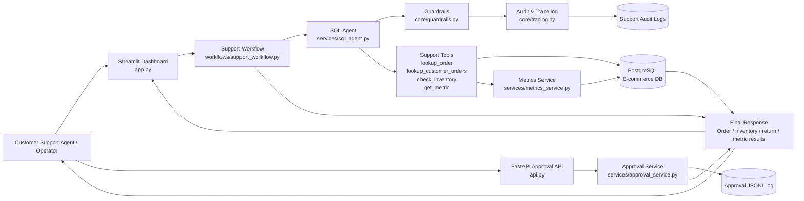

# CustomerSupportAssist architecture

## Workflow summary

1. A support user asks a natural-language question in the dashboard.
2. The workflow classifies the query as either read-only or action-based.
3. Guardrails validate whether the request is safe and within policy.
4. If the request is read-only, the SQL agent executes safe queries against the PostgreSQL database.
5. If the request attempts a return/refund/cancel action, it requires approval.
6. The approval-service writes the approval event to a JSONL log.
7. Every step is traced and stored in the audit log for observability and debugging.
8. The final result is displayed in the Streamlit app with clear evidence and trace details.

## Design principles

- Safe-by-default: all support queries are read-only unless a controlled approval path is used.
- Traceable: every tool call and workflow decision is recorded.
- Compliant: policy checks enforce approved tables and blocked SQL patterns.
- Operational: metrics and support data are surfaced for operations teams.
- Deployable: FastAPI and Streamlit can run together with Docker Compose.
