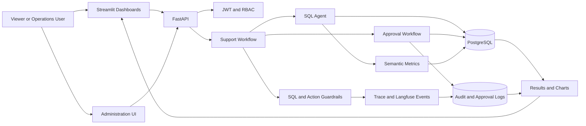

# ECommerceOps-Agent Architecture

## Runtime components

- **Streamlit dashboards:** support operations, analytics, and administration interfaces.
- **FastAPI API:** authentication, JWT authorization, support requests, approvals, metrics, and audit endpoints.
- **Support workflow:** intent classification, entity extraction, follow-up handling, and approval routing.
- **SQL agent:** natural-language-to-SQL generation and execution for approved read-only tables.
- **Guardrails:** SQL validation, blocked destructive statements, table allowlists, and approval-required actions.
- **PostgreSQL:** synthetic e-commerce data, users, and approval records.
- **Semantic metrics:** dbt-style definitions for revenue, returns, inventory risk, and support KPIs.
- **Tracing:** support audit events and optional Langfuse observability.

## Request flow

1. A user submits a natural-language request.
2. The workflow identifies the intent and required entities.
3. The guardrail layer validates read-only SQL or identifies an approval-required action.
4. Read-only requests may execute a generated SQL query against the allowlisted PostgreSQL tables.
5. Return, cancellation, inventory update, and refund operations create an approval request.
6. An operations manager approves, rejects, or cancels the request.
7. The workflow records the action and returns trace and audit evidence.
8. Streamlit presents tables, summaries, or charts according to the result shape.

## Security boundaries

- Read-only SQL is the default.
- Destructive SQL and multiple statements are blocked.
- Queries are restricted to configured tables.
- Sensitive actions require role authorization and human approval.
- PostgreSQL, JWT, provider credentials, and audit storage must be hardened for production.
